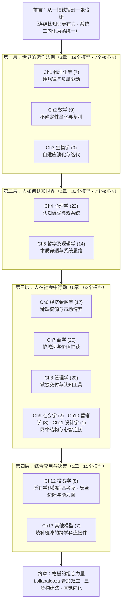

# 书名、简介、读者与结构

## 书名与副标题

- **书名：** 构建你的格栅思维
- **副标题：** 100+个思维模型的完整解码系统

## 本书简介

你有没有想过，为什么经济学家解释不了股市疯狂，为什么心理学家预测不了商业趋势，为什么物理学家设计不了成功的组织？

不是因为他们不聪明。是因为每个学科都只能摸到大象的一部分。

查理·芒格说过：「手里只有铁锤的人，看什么都像钉子。」如果你只懂经济学，你会用供需曲线解释一切；如果你只懂心理学，你会用认知偏差解释一切；如果你只懂工程学，你会用系统冗余解释一切。你都对，但你都只看到了一部分。

《构建你的格栅思维》不是一本模型词典——那样的书已经够多了。这本书真正要做的，是帮你把100多个思维模型编织成一张格栅，让你看到模型之间的连结：为什么物理学的临界点可以解释商业的飞轮效应，为什么心理学的认知误判可以预警投资的价值陷阱，为什么数学的复利可以贯穿从财富到知识到健康的所有领域。

全书按「世界的法则→人的认知→社会的行动→综合的应用」四层递进，从13个学科中提取100多个思维模型，标注核心模型深入展开——每个模型都配备故事、案例和跨学科连结。读完这本书，你不会变成每个学科的专家——但你会在面对复杂问题时，同时调用多个学科的视角，看到别人看不到的全貌。

手里不再只有一把铁锤，而是拥有一整座工具箱——以及工具与工具之间的连结图谱。

## 目标读者

**渴望升级思维框架的职场人。** 你在某个领域已经有积累，但隐约觉得自己被单一框架限制了——工程师想理解商业逻辑，产品经理想理解心理学，投资者想理解物理法则。你需要的是一座桥，不是一本教科书。

**践行查理·芒格理念的投资人。** 你读过了《穷查理宝典》，被格栅理论打动，但不知道从何搭建。100多个模型太多？先吃透核心模型，再看它们如何互连。

**面临复杂决策的管理者。** 你每天都在做判断，但直觉上知道单一视角不够——财务数据告诉你一个故事，团队情绪告诉你另一个故事，市场趋势告诉你第三个故事。你需要的是格栅，不是更多的数据。

**所有不想被单一学科限制的人。** 如果你相信世界比任何一门学科所描述的都更复杂，这本书就是为你写的。

## 读者收益

1. **建立跨学科判断力。** 掌握核心模型，面对问题时能同时调用多个学科视角。
2. **看见模型之间的连结。** 掌握连结地图——熵增→耗散结构→反脆弱→冗余备份，复利→排列组合→费马帕斯卡系统，认知误判→元认知→卡尼曼双系统→刻意练习。
3. **获得可操作的决策工具。** 每章配备实战练习、概率工具箱和可复用模板。
4. **理解Lollapalooza效应。** 多种力量同向作用时，结果不是加法而是指数级爆发。
5. **内化为直觉。** 通过刻意练习和元认知，将系统二的模型训练为系统一的直觉。

## 全书结构

排列逻辑：你必须先理解世界的法则，才能理解人的认知；必须先理解人的认知，才能理解人的行动；必须先理解人的行动，才能理解投资与决策。

## 写作风格与栏目设计

### 全书风格

有温度但不感性，有深度但不卖弄。模型分层，详略分明。模型不是孤岛，要串成逻辑链。融合作者实践。每个模型都要回答「所以呢？」。

### 固定栏目

**核心模型七点标准格式：** 一句话理解 → 模型提出者 → 模型介绍/概念 → 核心要素 → 实践/运用领域 → 与其他模型关系 → 其他

**次要模型精简版七点格式：** 保留同样七个栏目，每栏缩短至2-3句。

**每章开头三栏：** 📍破除焦虑 + 💡一句话心法 + 📊学科之眼

**每章结尾五栏：** 🔗跨学科连结 + 📋实战练习 + 📊概率工具箱 + 💰边际成本分析 + 📝可复用模板
