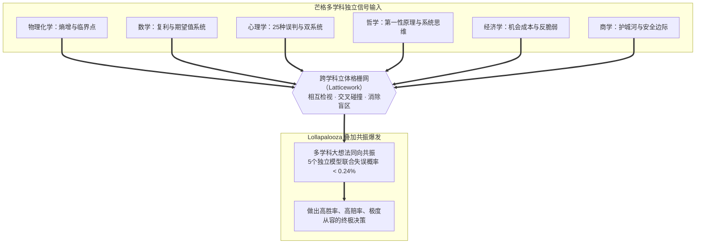

# IN-6 格栅理论 ⭐

**1. 一句话理解**

不是用一把锤子看世界——同时用物理、数学、心理、经济、商业的模型分析同一个问题，当多个模型同时指向同一结论时，lollapalooza效应产生。

**2. 模型提出者**

查理·芒格（Charlie Munger），在《穷查理宝典》中系统提出。芒格说：「你必须知道重要学科的重要理论，并经常使用它们——要全部都用上，而不是只用几种。大多数人只接受过一个学科的训练，试图用一种方法来处理所有问题。你知道那句老话：'手里只有铁锤的人，看什么都像钉子。'」

格栅理论的灵感来自跨学科教育的先行者——从亚里士多德的百科全书式知识体系，到笛卡尔的方法论，再到现代认知科学对专长与通的权衡研究。但芒格的独特贡献在于两点：第一，他不是在学术象牙塔中构建格栅，而是在几十年的投资实践中验证每一个模型的实用价值；第二，他发现了lollapalooza效应——当多个模型同向作用时，效果不是加法而是几何级数，这为跨学科思维提供了概率论上的坚实基础。

**3. 模型介绍/概念**

格栅理论是本书的基石——掌握不同学科的核心模型，建立多元思维框架，让知识在格栅的交叉点上产生lollapalooza效应。

「格栅」这个词的意象很精确：想象一张栅格网，每一条竖线代表一个学科，每一条横线代表一个问题。单一学科的专家只能看到竖线上的节点——物理学家看世界全是物理法则，经济学家看世界全是供需曲线。而格栅思维者看到的是所有交叉点——同一个问题，物理视角告诉你临界点在哪里，数学视角告诉你概率和赔率如何，心理视角告诉你你自己可能有什么偏差，经济视角告诉你机会成本多大，商业视角告诉你护城河是否够宽。

在投资决策中，格栅理论意味着不从单一模型出发——不要只用财务模型看企业。你还要用心理学看管理层的认知偏差（他们是否过度自信？是否在用沉没成本支撑错误的战略？），用生物学看行业的进化方向（哪些物种在变异？哪些生态位在空出？），用物理学看增长的临界点（增长是否接近相变的拐点？阻力是否在非线性增加？），用数学看收益的概率分布（是正态分布还是幂律分布？极端情况有多极端？）。当一个学科的模型指向「买」而另一个学科的模型指向「不买」时，你需要更深入的分析；当五六个学科的模型同时指向「买」时，那个信号的可靠性远超任何单一分析——这就是lollapalooza效应。

lollapalooza效应的概率基础：当5个独立模型同时指向同一结论，每个模型正确率70%，那么5个同时错误的概率是(1-70%)^5≈0.24%。换言之，当5个学科的视角都指向同一方向时，你犯错的概率不到1%。这不是信心——这是数学。相反，如果你只用一个70%正确率的模型做决策，犯错概率高达30%。格栅理论不是让你用更多的模型来装饰分析报告，而是让多个独立信号交叉验证，把不确定性降到最低。

格栅理论还是全书的终极汇聚点。让我们回顾一下前十一章的每一门学科如何汇聚到这张格栅上：

- **物理化学**（第1章）：[熵增定律](../01_physics_chemistry/PC-1_entropy_law.md)告诉你持仓会自然退化，[临界点](../01_physics_chemistry/PC-2_critical_point.md)告诉你增长不是线性的，[倾覆力矩](../01_physics_chemistry/PC-7_overturning_moment.md)告诉你仓位就是杠杆。物理视角让你看到底层的结构力量——趋势、惯性与相变。
- **数学**（第2章）：[复利](../02_mathematics/MT-1_compound_interest.md)是投资收益的终极来源，[费马帕斯卡系统](../02_mathematics/MT-4_fermat_pascal.md)是每一次下注的基础，[排列组合](../02_mathematics/MT-2_permutation_combination.md)告诉你模型的组合产生新洞察，[幂律分布](../02_mathematics/MT-7_power_laws.md)告诉你收益不是正态的——少数几笔投资贡献绝大多数收益。
- **生物学**（第3章）：[现代达尔文综合模型](../03_biology/BI-1_darwinian_synthesis.md)告诉你护城河不是永恒的——环境变了，曾经最强的适应者也会被淘汰；[生物学思维](../03_biology/BI-2_biological_thinking.md)帮你找到行业生态位中自适应演化的企业。
- **心理学**（第4章）：[认知误判模型](../04_psychology/PS-1_cognitive_biases.md)是投资的头号敌人，[卡尼曼双系统](../04_psychology/PS-11_dual_system.md)让你在市场狂热或恐慌时唤醒系统2，[元认知](../04_psychology/PS-8_metacognition.md)让你反思自己的决策过程。投资中最大的对手不是市场，而是自己。
- **哲学及逻辑学**（第5章）：[第一性原理](../05_philosophy/PH-2_first_principles.md)让你从最基本的事实出发估值，[奥卡姆剃刀](../05_philosophy/PH-1_occams_razor.md)让卖出理由回归本质，[逆向思维](../05_philosophy/PH-6_inversion.md)让你先排除最危险的可能性，[系统思维](../05_philosophy/PH-8_systems_thinking.md)让你看到反馈回路。
- **经济金融学**（第6章）：[机会成本](../06_economics/EC-1_opportunity_cost.md)是估值的终极基准，[反脆弱](../06_economics/EC-6_antifragile.md)让投资组合从市场波动中获益，[均值回归](../06_economics/EC-7_mean_reversion.md)提醒好到不真实的估值终将回归。经济学提供了决策的量化算盘。
- **商学**（第7章）：[安全边际](../07_business/BU-1_margin_of_safety.md)保护判断的误差，[飞轮效应](../07_business/BU-12_flywheel_effect.md)揭示竞争优势的自增强，[颠覆式创新](../07_business/BU-18_disruptive_innovation.md)预判谁会被时代淘汰。商学模型是格栅中最具实操性的商业透镜。
- **管理学**（第8章）：[双目标清单](../08_management/MA-16_two_list_system.md)排除杂念聚焦核心圈，[清单思维](../08_management/MA-15_checklist_thinking.md)在买入卖出前逐条排雷，[组织心智](../08_management/MA-14_organizational_mind.md)帮你看透被投企业的执行文化。
- **社会学**（第9章）：[结构洞](../09_sociology/SO-2_structural_holes.md)帮你识别产业链中利润最丰厚的连接节点，[网络效应](../06_economics/EC-4_network_effect.md)筑起最坚实的护城河，社会网络揭示羊群效应与信息级联。
- **营销与设计学**（第10~11章）：[定位理论](../10_marketing/MK-1_positioning.md)衡量品牌在消费者心智中的产权宽度，[需求三角](../10_marketing/MK-3_demand_triangle.md)与[设计思维](../11_design/DE-1_design_thinking.md)帮助判断产品是否真正击中真实痛点。

十一门学科，各自的核心模型在这张格栅上交叉、验证、共振。当物理的熵增、数学的复利、心理的认知误判、经济的机会成本、商业的安全边际同时指向同一个方向时，Lollapalooza 效应爆发——你不是在主观猜测，你是在用多学科法则联合计算。

**4. 核心要素**

第一，掌握多学科的核心模型——你不需要成为每个学科的专家，但你需要掌握每个学科最核心的几个模型。第二，建立模型之间的连结地图——知道哪些模型互相验证、哪些互相矛盾、哪些互补。第三，决策时调用多个模型的组合——不是用更多模型装饰报告，而是让多个独立信号交叉验证。第四，多模型同向作用产生lollapalooza效应——当五六个学科同时指向同一结论时，犯错的概率极低，这才是下重注的时刻。

**5. 实践/运用领域**

在投资中，综合多学科分析企业——每一笔投资决策都是一次格栅的全面调动。在复杂决策中，调用多模型交叉验证——越是重要的决策，越需要更多的独立信号。在任何需要判断力的场景中，不依赖单一框架——单一模型的判断是脆弱的，多模型的判断是反脆弱的。

**6. 与其他模型关系**

→ 全书的汇聚点：所有其他章节的模型都在这里交汇、组合、共振。格栅理论不是第12章的模型，它是全书的模型——前11章的所有内容都是格栅上的一条竖线，第12章是它们交汇横切的那一刻。→ [系统思维（PH-8）](../05_philosophy/PH-8_systems_thinking.md)：格栅理论是系统思维在知识层面的应用——系统思维关注要素间的连接，格栅理论关注学科间的连接。→ [排列组合（MT-2）](../02_mathematics/MT-2_permutation_combination.md)：模型的排列组合产生新洞察——两个模型的组合不是1+1=2，而是可能产生全新的视角。→ 认知误判/[lollapalooza倾向（PS-1）](../04_psychology/PS-1_cognitive_biases.md)：lollapalooza效应既可以是偏差的共振（导致灾难性决策），也可以是智慧的共振（导致高质量决策）——区别在于你是被它操控，还是主动利用它。→ [能力圈（IN-2）](IN-2_circle_of_competence.md)：格栅理论扩展你分析问题的工具，但不扩展你的能力圈——你可以用多个学科分析一个公司，但如果你不理解这个行业，再多学科也救不了你。

**7. 其他**

芒格说：「如果你只有一把锤子，看什么都像钉子。」这句话的另一半是：如果你有一把锤子、一把锯子、一把尺子、一盏灯和一个水平仪，你看同一面墙时，能看到裂缝、看到垂直度、看到材质、看到光线如何改变它的外观——你看到的不再是「一面墙」，而是一个完整的系统。这就是格栅。

投资是格栅理论的终极考场：你不可能用财务分析解决所有问题，也不可能用心理学对冲所有风险——你需要所有的学科，在正确的时刻，以正确的方式，同时发力。当这一切发生时，lollapalooza效应让你的决策从「也许是对的」变成「几乎不可能错」。

---
