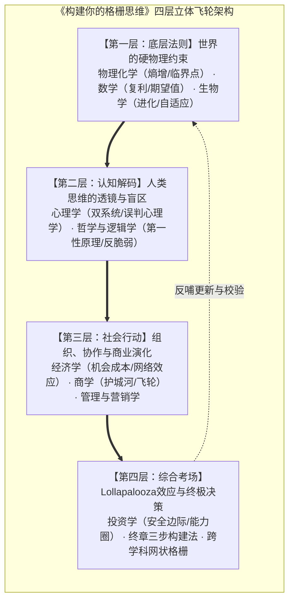
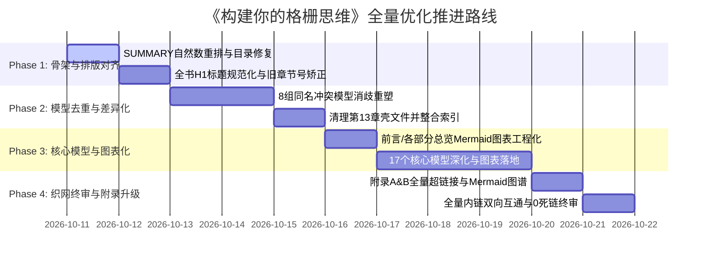

# 《构建你的格栅思维》全书系统级优化 PRD 方案

> **文档版本**：v1.0.0  
> **制定日期**：2026-10-11  
> **项目代号**：Latticework-Wiki-Full-Refactor  
> **关联仓库**：[terryhk/model-thinking-wiki](https://github.com/terryhk/model-thinking-wiki)  
> **方法论参考**：[AI-First-Note 优化方法论](../ai-first-note/OPTIMIZATION_PRD.md)  
> **文档定位**：格栅思维体系重构、认知图表工程化、网状链接织网与决策系统升级方案  

---

## 1. 项目背景与全书愿景

### 1.1 现状与核心痛点审计

《构建你的格栅思维》（model-thinking-wiki）是一部致力于将查理·芒格“多元思维模型格栅”落地的知识专著。作者结合网络工程师与产品经理的实战背景，从 13 个学科提炼了 114 个思维模型，确立了“**宇宙趋向混乱，有序需要能量；概率照亮方向，迭代逼近正确**”的核心认知底层。

然而，对照 **AI First Note 现代数字知识库/出版级电子书标准** 深度审计后，发现当前仓库存在以下 5 大结构性硬伤：

1. **目录索引排序硬伤（字典序 Bug）**：
   - `SUMMARY.md` 中第 4~8 章的小节按纯文本字典序排序，导致 `PS-10 ~ PS-19` 排在 `PS-1` 之前，`PS-20 ~ PS-22` 插在 `PS-2` 之前，严重破坏了阅读逻辑与章节递进性。
2. **跨章节引用历史遗留严重断层**：
   - 全书多处正文存在旧版本章节编号残留（例如：在第 1 章将经济学引为“第四章”、投资学引为“第五章”、心理学引为“第七章”；在第 8 章与第 9 章引用时章节号同样错位）。
3. **模型同名冲突与功能冗余（8 组重复）**：
   - 存在 8 组高重复甚至完全同名模型（如 `影响力模型` 出现在心理学 PS-10 与管理学 MA-1；`SWOT分析` 出现在商学 BU-2 与管理学 MA-4；`二阶思维` 出现在哲学 PH-11 与投资学 IN-4；`竞争进化`、`冲浪模型` 在其他模型中仅写了一句“详见第X章”）。
4. **图表工程化为 0（认知呈现负荷高）**：
   - 全书 167 个 Markdown 文件中，现代 **Mermaid 图表数量为 0**；前言 0.3 与附录 B 甚至仍在使用极易错位且难以交互的 ASCII 字符画方框。
5. **“格栅”形同虚设（缺乏双向超链接）**：
   - 芒格强调格栅的精髓在“模型之间的连线”，但目前全书几乎所有章节第 6 部分“与其他模型关系”、附录 A（114 个模型速查表）及附录 B（34 条连结图谱）中，**模型全部为纯文本，0 处 Markdown 超链接**，读者完全无法在模型间点击穿梭漫游。
6. **标题层级规范割裂**：
   - 第 0~5 章各模型文件开头使用一级标题 `# 模型名`，第 6~12 章却全部使用三级标题 `### 模型名`，格式严重不统一。

---

### 1.2 升级愿景（Vision）

将本书从目前的**“114个模型词条卡片集”**全面升级为**“真正可漫游、可组合、可指导复杂决策的格栅思维操作系统”**。

通过**“世界的物理底层 $\to$ 人类的认知透镜 $\to$ 社会的博弈行动 $\to$ 终极的决策与投资考场”**四层飞轮架构，让每一个模型不仅有严密推导与真实商业/生活案例，更通过工程化超链接与 Mermaid 交互图谱，真正形成芒格所说的“跨学科格栅网络”。

---

## 2. 优化目标与量化指标（Goals & Metrics）

| 目标维度 | 现状 | 目标状态（Target） | 衡量指标 |
| :--- | :--- | :--- | :--- |
| **目录与章节一致性** | SUMMARY.md 字典序错乱，历史章节号错位 | 全书小节按自然数严谨递进，全书章节交叉引用 100% 修复 | 0 处章节号矛盾，目录排序 100% 正确 |
| **格栅网络化（链接密度）** | 模型关系与附录索引为纯文本，0 超链接 | 附录A、附录B、各模型关系段落全部转换为绝对/相对跳转链接 | 全书网状超链接数 $\ge 300+$ 处 |
| **视觉呈现与图表化** | Mermaid 覆盖率为 0，含 2 处 ASCII 字符画 | 为核心模型、前言、附录及各章梳理引入 **25+ 处高清 Mermaid 图** | 17 个 ⭐ 核心模型与附录全覆盖 |
| **模型去重与差异化重构**| 8 组模型同名或互相推诿引用 | 统一规范：同名模型差异化重塑（侧重不同学科视角）或合并重定向 | 消除所有无意义的占位壳小节 |
| **工程排版规范度** | H1 与 H3 混用，部分小节 <30 行 | 全书模型统一为标准 H1，短小骨架小节扩充真实落地案例 | 标题规范通过率 100%，消除空洞小节 |

---

## 3. 详细优化方案与模块工作拆解（WBS）

### 模块一：全局骨架修复与排版规范化（Global Hub & Standards）

1. **`SUMMARY.md` 索引自然数重排**：
   - 修复第 4、5、6、7、8、12、13 章的排序逻辑，确保 `PS-1` 到 `PS-22`、`BU-1` 到 `BU-20` 按数值顺序排列。
2. **标题格式全量归一化**：
   - 批量修复第 6~12 章模型文件中起始的 `###` 为规范的 `#` 一级标题。
3. **跨章节引用历史遗留纠偏**：
   - 全局扫描并修正 `01_physics_chemistry/README.md`、`12_investing/IN-6_latticework.md`、`08_management/MA-20_mindmap.md`、`09_sociology/SO-1_fogg_behavior_model.md` 中的旧版章节指代，建立正确的全书坐标系。

---

### 模块二：模型去重、消歧与学科视角差异化重塑（Deduplication & Differentiation）

针对 8 组重复模型，采取明确的“学科视角区分原则”，拒绝简单机械复制：

| 冲突模型 | 学科分布 | 重塑与分工方案 |
| :--- | :--- | :--- |
| **影响力模型** | PS-10 (心理) vs MA-1 (管理) | **PS-10** 聚焦于人类进化的快捷心智与自我防御；**MA-1** 改写为《管理影响力：无职权领导与组织协同》，聚焦于管理者如何运用社会认同与互惠推进项目。 |
| **SWOT分析** | BU-2 (商学) vs MA-4 (管理) | **BU-2** 聚焦企业外部竞争与业务战略定位；**MA-4** 改写为《个人与团队技能 SWOT：资源盘点与敏捷匹配》。 |
| **二阶思维** | PH-11 (哲学) vs IN-4 (投资) | **PH-11** 侧重因果链推导与系统副作用防范；**IN-4** 侧重投资交易中的市场二阶博弈与预期差（Mr. Market 的预期反转）。 |
| **信息传递** | EC-16 (经济) vs MA-17 (管理) | **EC-16** 侧重哈耶克价格机制、市场信号理论与逆向选择；**MA-17** 侧重香农信道损耗、组织汇报漏斗与沟通确认机制。 |
| **增长要素** | EC-17 (经济) vs BU-15 (商学) | **EC-17** 侧重索洛增长模型（资本、劳动、技术全要素生产率）；**BU-15** 侧重企业业务微观增长飞轮（CAC/LTV、转化漏斗）。 |
| **定位理论** | BU-16 (商学) vs MK-1 (营销) | **BU-16** 侧重企业心智护城河与竞争壁垒（防守）；**MK-1** 侧重心智占领策略与品牌打法（进攻）。 |
| **竞争进化 & 冲浪** | BU-19/20 vs OT-2/PNI-1 | 消除 `13_other_models` 中的空壳引用（“详见第X章”），将 13 章聚焦于真正独立的跨学科补充模型，重构索引。 |

---

### 模块三：核心模型深化与 Mermaid 图表工程化（Diagrams & Depth）

为全书核心骨架注入高清晰度的 Mermaid 流程图、时序图与架构图，消除枯燥文本：

1. **前言与总览**：
   - 将 `00_preface/0.3_book_structure.md` 中的 ASCII 框图全面升级为现代化四层联动 Mermaid 架构图；
   - 在各 `partX_.../README.md` 中增加本部分知识流动图。
2. **17 个 ⭐ 核心模型 Mermaid 赋能**：
   - **PC-1 熵增定律**：孤立系统熵增 vs 开放耗散系统负熵注入飞轮；
   - **PC-2 临界点**：相变临界曲线与非线性收益爆发图；
   - **MT-1 复利**：复利周期拐点与微小增量积累示意图；
   - **MT-4 费马帕斯卡系统**：凯利公式与赔率-概率决策矩阵；
   - **PS-1 认知误判**：芒格 25 种误判倾向的脑图结构；
   - **PS-11 卡尼曼双系统**：System 1 (直觉反应) 与 System 2 (理性调控) 交互协作图；
   - **PH-2 第一性原理**：归纳法（比较思维）vs 演绎法（本质还原）对比图；
   - **PH-8 系统思维**：存量、流量、正负反馈回路闭环图；
   - **EC-1 机会成本**：决策边界与隐性代价漏斗；
   - **EC-6 反脆弱**：脆弱（倒U型）、强韧（水平线）与反脆弱（凸性增长）曲线对比；
   - **BU-1 安全边际**：内在价值波动 vs 市场买入价的安全缓冲示意图；
   - **IN-3 护城河**：巴菲特 5 种护城河（无形资产/转换成本/网络效应/成本优势/规模）防御矩阵；
   - **IN-6 格栅理论**：多学科交织的 Lollapalooza 叠加效应网络图。

---

### 模块四：附录全景图谱网格化与双向超链接织网（Latticework Linking）

1. **附录 A（114 个模型速查索引）全面超链接化**：
   - 将表格中 114 个模型名称全部替换为对应的 Markdown 相对路径，实现从附录一键直达任意模型。
2. **附录 B（跨学科连结图谱）现代图谱化与可点击化**：
   - 将原有脆弱的 ASCII 字符画网络图彻底替换为 **Mermaid 交互网络图**（`graph TD` / `flowchart LR`）；
   - 34 条跨学科连结全部配上源模型与目标模型的超链接跳转，并在两侧模型正文中建立反向链接，真正织成一张“格栅”。
3. **正文第 6 部分“与其他模型关系”全量超链接激活**：
   - 将所有模型文件中的 `→ 模型名称（编号）` 统一转化为可点击的 Markdown 内部链接。

---

## 4. 执行计划与分阶段路线图

### 分阶段交付策略（分批推进，随时可验）
- **第一阶段（Phase 1，基础骨架）**：修复 `SUMMARY.md` 自然数排序、统一标题层级为 H1、校准所有错位章节引用。
- **第二阶段（Phase 2，去重定界）**：对 8 组重复模型进行差异化重塑或整合，消除“详见第X章”等无意义外壳。
- **第三阶段（Phase 3，图表赋能）**：替换 ASCII 字符图，为 17 个 ⭐ 核心模型与架构绘制 25+ 处 Mermaid 架构图，扩充骨架小节。
- **第四阶段（Phase 4，全域织网）**：附录 A、B 全量超链接化，全书正文关联关系织网，运行自动化脚本校验 0 死链。

---

## 5. 待用户确认事项清单（Checklist for User Approval）

在正式批量修改文件前，请您确认以下关键事项：

1. **重复模型处理策略确认**：
   - **方案 A（推荐）**：保留模型编号（避免大规模影响外部引用），但按“学科视角差异化”重写（如 PS-10 讲个体心智防御，MA-1 讲组织无职权领导；BU-2 讲企业战略，MA-4 讲个人敏捷技能）；对于第 13 章完全空壳的模型，补充实质性内容或精简。
   - **方案 B**：彻底合并同名模型，重新编排编号（例如统一缩减为 100 个模型整）。
2. **图表绘制风格确认**：
   - 是否同意全量采用现代化 **Mermaid 规范**（流程图、时序图、概念网络图）替代全书现有的 ASCII 方框图，并在 17 个核心模型中深度植入？
3. **推进节奏确认**：
   - 是否同意按照 **Phase 1（骨架修复与目录排序） $\to$ Phase 2（重复模型消歧） $\to$ Phase 3（图表工程化与核心深化） $\to$ Phase 4（全书织网与附录打通）** 的节奏分步推进？每完成一个 Phase 向您汇报产出。
