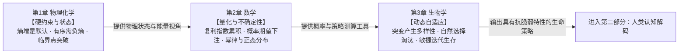

# 第一部分：世界的运作法则

> 理解宇宙的底层规律，建立对世界运行方式的根本认知

---

第一部分解决一个问题：**世界到底怎么运行？**

不是「世界是什么」——那是哲学的领域。而是：支配万物运行的最底层法则是什么？这些法则有多确定？在不确定中如何演化？

这一部分的逻辑线，层层递进：

- **[物理化学](../01_physics_chemistry/README.md)**（第1章）：世界运行的最底层法则是什么？→ 熵增是默认趋势，临界点是非线性转折，自催化是正反馈的物理原型
- **[数学](../02_mathematics/README.md)**（第2章）：这些法则有多确定？→ 复利描述增长的非线性，概率描述不确定性的量化方法，幂律与正态分布描述世界的两种基本模式
- **[生物学](../03_biology/README.md)**（第3章）：不确定的世界如何演化？→ 进化是机制，迭代是策略，条件反射是工具

读完第一部分，你会建立一套根本性的认知框架——面对任何现象，你会先问「这是熵增在起作用，还是临界点即将到来？这是幂律分布的尾部，还是正态分布的中心？这是需要精确控制，还是需要迭代适应？」这是全书的根基：不理解世界的法则，就无法理解人的认知；不理解人的认知，就无法理解人的行为。

