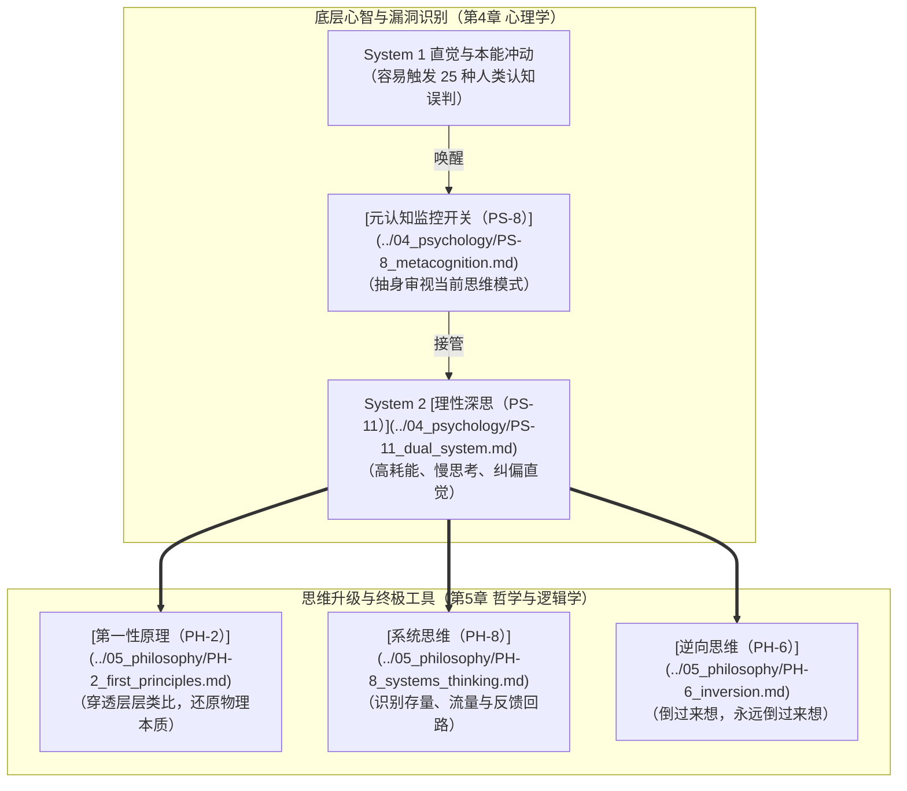

# 第二部分：人如何认知世界

> 理解大脑的默认模式，避开认知陷阱，学会正确地思考

---

第二部分解决一个问题：**你的大脑如何理解世界——以及为什么会经常出错？**

不是「大脑怎么工作」——那是神经科学的领域。而是：你的认知系统有哪些出厂bug？你如何发现它们？你如何纠正它们？你如何从根本上改善思考的质量？

这一部分的逻辑线，层层递进：

- **[心理学](../04_psychology/README.md)**（第4章）：你的大脑有哪些系统性偏差？→ 认知误判是系统1的bug清单，元认知是系统2的开关，刻意练习是修复bug的方法
- **[哲学及逻辑学](../05_philosophy/README.md)**（第5章）：如何正确地思考？→ 第一性原理教你穿透表象，系统思维教你看到整体，逆向思维教你从反面验证

读完第二部分，你会建立一套认知校准系统——面对任何判断，你会先问「这是系统1的直觉还是系统2的分析？我有没有被认知偏差劫持？我的前提是否经得起第一性原理的检验？我是否看到了系统整体而非局部？」卡尼曼双系统是底层架构，认知误判是bug清单，元认知是校准开关，刻意练习是修复方法，第一性原理和系统思维是终极工具。

