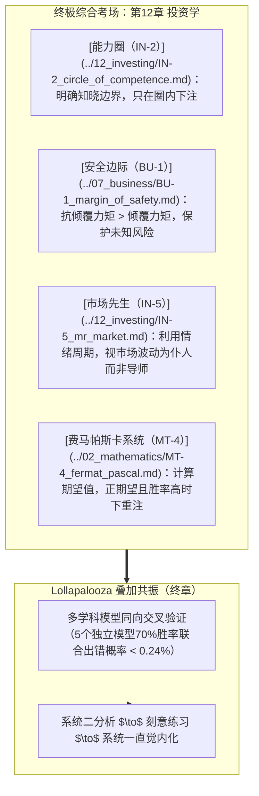

# 第四部分：综合应用

> 所有学科的综合考场——投资是格栅思维的终极检验

---

第四部分解决一个问题：**当你掌握了跨学科的格栅，你如何用它做出更好的决策？**

投资是所有思维模型的综合考场——没有哪个领域像投资一样，需要同时调用概率、心理、经济、管理、物理等多学科的知识。这一部分不是教你炒股，而是用投资作为最极致的实战场景，展示格栅思维如何从理论走向决策。

这一部分的逻辑线：

- **[投资学](../12_investing/README.md)**（第12章）：如何用格栅做出更好的投资决策？→ 安全边际、能力圈、市场先生、费马帕斯卡、反脆弱
- **[其他模型](../13_other_models/README.md)**（第13章）：补完格栅的最后一块 → 递弱代偿、冲浪模型、竞争进化等跨界模型
- **[终章](../14_conclusion/README.md)**：格栅的组合力量

读完第四部分，你会意识到：投资决策不是单一学科的应用，而是所有学科的共振——这就是Lollapalooza效应。当安全边际、能力圈、费马帕斯卡系统和反脆弱四种力量同向作用时，你的决策质量不是线性提升，而是指数跃迁。

